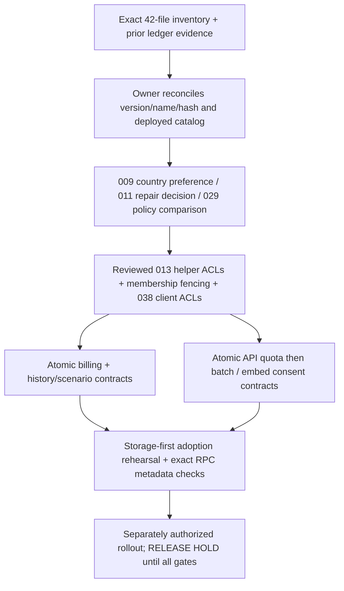

# Migration history and release-contract reconciliation

**RELEASE HOLD.** Baseline cumulative draft #1459 `fd1c0be4d0b10662097019f07e7a4f5c40848a18`; all six baseline CI checks passed. This task performs repository investigation and disposable PostgreSQL mutations only. No production query or write, historical migration edit, deployment, payment, certification or publication occurred.

## Exact inventory and tested order

- `migration-contract-2026-10-20/inventory.json` and `.csv`: **42 exact repository migrations, eight proposal documents** (seven SQL files plus embedded billing SQL), SHA-256s, candidate positions, lexical object references, bounded dependency candidates and prior ledger-fingerprint evidence.
- Prefix032 has `032_atomic_reviewer_qa_audit.sql` and `032_business_builder_rls_auth_initplan.sql`;033 has `033_atomic_reviewer_assignment_audit.sql` and `033_pro_workspace_rls_auth_initplan.sql`;034 has `034_atomic_lifecycle_transition_audit.sql` and `034_billing_webhook_event_privileges.sql`;035 has `035_atomic_catalog_creation.sql` and `035_split_overlapping_write_policies.sql`.
- `008b_b10_alert_automation.sql` follows008 and precedes009 in the tested candidate. There is no015 file; no missing migration name or deployment event is invented. This numbering gap alone is not a proven release blocker.
- Candidate order: numeric prefix, empty suffix before alphabetic suffix, then exact filename within duplicate prefixes. **This is a tested disposable order, not an authorized production timestamp map or migration executor.** Exact filenames are never renamed or deduplicated by prefix. The full sequence is exported in JSON rather than repeated here.
- Dependency candidates/object references are explicitly not a complete SQL parser. Successful full candidate execution proves this sequence works on the modeled prerequisites; it does not prove equivalence for every existing installation.

## Evidence provenance: repository is not deployment

Current protected production evidence is **UNKNOWN**. The managed environment reports ready anonymous Supabase URL/key configuration, no privileged SQL/catalog connector and no outbound privileged identity. Anonymous configuration cannot establish migration bodies, function owners, protected policies or effective role inheritance. This task does not repeat failed protected-access probes or perform live authentication experiments.

The existing `ACCOUNT-MIGRATION-RECONCILIATION-2026-10-19.md` records prior read-only observations:37 migration-ledger rows, no `country_preferences` ledger entry, missing `user_preferences.country_code`, existing `profiles.display_name`, and production billing/RLS facts inherited by the cumulative work. These are dated evidence, not refreshed current attestations. Four fingerprint comparisons are reused:

| File | Prior ledger comparison | What remains unknown |
| --- | --- | --- |
|001_b3_accounts | EXACT_MATCH | Current schema effects/ownership/grants can drift after application |
|002_b4_billing | EXACT_MATCH | Current effective billing privileges and provider semantics |
|029_account_rls_auth_initplan | UNRESOLVED_DIFFERENCE | Normalized executable policy bodies/roles/USING/WITH CHECK need owner comparison; matching clause counts are insufficient |
|034_billing_webhook_event_privileges | COMMENT_STRIPPED_MATCH | Comment normalization is diagnostic, not proof of current effective ACLs |

No automatic42→37 mapping is inferred from the counts. The complete37-row body/identity export is unavailable here. Every inventory row retains `deployedState: UNKNOWN`, including files in the migrations directory and proposals with successful tests.

Optional owner-run collection: `tests/migration-contract/owner-readonly-evidence.sql`. It opens a read-only transaction and exports ledger statement digests plus bounded table/function/trigger/policy/constraint and effective role/column/table/EXECUTE metadata. It excludes application rows, function bodies, credentials, provider payloads and reviewer identities; only function search-path settings are included. The ledger digest contract is explicit and is **not** assumed identical to repository byte hashing. The script fails when protected objects/permissions are unavailable; failure is not zero evidence. No production execution is authorized by inclusion of the query. Default privileges, external writers and owner-held full-definition comparisons remain separate review evidence.

## Fresh-install and upgrade acceptance

`tests/migration-contract/combined.postgres.mjs` uses one digest-pinned PostgreSQL16 container, internal Docker network, tmpfs data and no published ports. Three databases isolate the paths; roles/auth helpers/platform grants are synthetic. `disposable-results.json` records exact sequences, transformations, cases and the expected raw failure.

| Path | Actual result | Meaning / limits |
| --- | --- | --- |
| Raw exact historical fresh replay | **BLOCKED** at unchanged011: PostgreSQL42601 unterminated dollar quote, after11 successful files | Original source is not installable end-to-end; this expected failure remains visible |
| Candidate fresh manifest | **VERIFIED_DISPOSABLE:**41 unchanged repo files + versioned additive repair proposal in place of omitted011 | Guard removed only in disposable stdin; not an unmodified42-file fresh-install pass and not a deployment-ledger repair |
| Production-shaped upgrade model | **VERIFIED_DISPOSABLE:**41 repo files,009 omitted,011 terminator corrected only in memory | Preserves missing country_code; models the known shape, not the actual37-row production sequence, schema or ACL provenance |
| New repair against existing corrected contract | **REFUSED**, function unchanged | No overwrite of an unknown deployed function/trigger; owner comparison required |
| Original seven proposals together | **VERIFIED_DISPOSABLE:** guarded refusal/catalog preservation and combined boundaries pass | No production atomicity, external-provider consistency or exactly-once delivery claim |

**11 combined cases pass.** They cover the additive repair guard/refusal, all seven original proposal guards (including SQL clients that continue after errors), partial helper-grant rollback, billing downgrade racing history/scenario writes, duplicate old paid receipts not restoring canceled plans, late billing rollback preserving quota/API gates, shared API/batch budget, membership owner/identity fencing, embed consent/receipt rollback and duplicate replay, combined ownership/RLS/038 grants, eleven RPC owner/path/effective EXECUTE checks, and read-only evidence-query compilation/no mutations with an explicitly empty synthetic ledger. That empty ledger is not the37-row production record.

Baseline #1459's20 real HTTP/PostgREST cases and42 private save/reopen roundtrips across14 calculators/three plans are reused for unchanged application/SQL behavior. This aggregate harness adds cross-contract database evidence; it does not repeat or replace real transport tests. Physical Android/TalkBack and GoTrue/cookie/session-revocation checks remain UNVERIFIED.

## Versioned additive repair proposal

`docs/architecture/proposals/20261020-v1-legacy-save-quota-repair.sql` is a **review artifact v1**, not a reserved Supabase timestamp/version or a migration applied by this task.

- Repairs only the missing011 legacy function and its two named triggers, preserving authored Free10 favorites/Free20 history behavior, search path and EXECUTE revocations. It is **not an atomic quota correction**; the reviewed atomic history guard is still required.
- Always aborts in an explicit transaction unless its guard is deliberately removed for isolated acceptance or a future separately authorized adoption.
- Requires existing profiles/favorites/history tables; refuses if the function or either named011 trigger already exists. No `OR REPLACE`, DROP, CASCADE, application-row mutation or historical ledger update.
- Fresh adoption needs an explicit owner manifest omitting broken011 and assigning a new reviewed version to the repair. An additive migration after a runner has already stopped at011 cannot magically repair that runner's history. Existing installations need function/trigger comparison before deciding whether any repair is necessary.
- Search path/public-schema CREATE and trusted ownership remain owner review requirements. Existing legacy races are not concealed; all history writers need the atomic guard and favorites retain their separate existing quota limitation.

## Application writers and unapplied dependencies

| Writer / path | Storage dependency | Missing/old contract behavior |
| --- | --- | --- |
| Subscription webhook: `src/app/api/billing/webhook/route.ts` → `src/lib/billing/atomic-webhook.ts` | Billing fence/completion/apply RPCs plus proposed fence/completion tables and reviewed billing schema | Missing/invalid RPC evidence fails closed; no subscription REST fallback |
| Other signed webhook receipts in same route | Existing `billing_webhook_events` uniqueness, read/insert grants and strict payload reconciliation | Retained independent receipt insert; does not update entitlements. It is not an atomic subscription-write bypass |
| Browser, generic server and14 private DRAFT history saves → `src/lib/account-persistence.ts` | `save_calculation_history_atomic(uuid,text,integer,jsonb,jsonb,uuid)` + immutable/quota guards | Missing/mismatched RPC fails closed; expected owner is a JWT equality fence; no count/REST fallback |
| Account scenario copy: `src/app/account/actions.ts` | `save_project_scenario_atomic(uuid,uuid,uuid,text,uuid)` + owned immutable source | Missing contract fails closed; form retains request UUID for uncertain retry |
| Project create / scenario rename REST paths in same actions | Existing010 owner policies plus proposed workspace/profile-lock triggers | Can retain legacy semantics if triggers are absent; application presence alone does not establish atomic plan fencing. Owner adoption preflight required |
| API authorization: `src/lib/api/auth.ts` | Replaced `consume_business_api_quota(uuid)` body from atomic-quota proposal | **Same signature exists in006. RPC existence alone cannot detect legacy non-atomic behavior.** Require reviewed definition/effective-grant evidence; no runtime freshness guarantee inferred |
| Batch create/recovery: `src/app/api/v1/batch/route.ts` | `submit_verified_batch_job_v1`, `read_verified_batch_job_v1`, batch receipts, atomic quota locking | Missing new RPCs fail closed; every relevant quota writer must use the same reviewed key lock |
| Lead capture: `src/app/api/embed/[key]/leads/route.ts` | `capture_verified_embed_lead_v1` + consent/receipt transaction and publication/owner checks | Missing contract fails closed; no split lead/consent fallback |
| Membership/organization mutations and existing Business RPCs |013 ACLs, helper repair + membership fence policy/triggers | Existing signatures can have stale policy/trigger semantics. Invoker fencing can deny maintenance/service contexts; no service bypass is invented |
| Account preferences read/upsert |009 `country_code` + owner policies/038 allowed insert-update columns | Prior production shape lacks required column; current state UNKNOWN and owner schema preflight required |

Deletes preserve owner/RLS cleanup and immutable snapshots. Deleting a saved request row removes replay memory; no deletion-surviving exactly-once guarantee is claimed. Local preview storage is not authenticated persistence. Source-only inventory cannot attest external maintenance/admin writers. Other API run logs, favorites, AI usage and billing-provider systems retain separate policies and are not promoted to new transaction guarantees here.

## Ordered owner decisions and rollout/recovery proposal

1. **Reconcile identities before executable SQL.** Database/integration owner supplies dated protected metadata and the complete37-row ledger identities/hashes. Match by exact name/body/effect, never numeric prefix. Decide009 absence,011 source repair versus an already-correct deployed function,029 policy drift, record015 as unassigned unless the ledger supplies evidence,008b ordering and duplicate032–035 filenames. UNKNOWN is not approval.
2. **Authorize a versioned manifest separately.** Choose the actual migration executor and new timestamp identities. Do not rename/rewrite historical files, fabricate applied ledger rows or blindly replay all42 files against production.038 is a review-only proposal even though it is under `supabase/migrations`.
3. **Approve security and writer contracts.** Database/security owner selects trusted definer owner, fixed search paths, effective/inherited/default/column ACLs and least-privilege RPC execution. Billing/application owner attests every plan/subscription writer participates in local fencing, provider evidence semantics and retry policy. Review profile row-version updates, maintenance/service operations, lock order, data retention and legacy receipts. Specialist/publication authority remains separate.
4. **Rehearse the approved upgrade.** Use the actual sanitized schema/ledger evidence to replace the current model; test preserved existing rows/constraints and full rollback/recovery. The present combined model is not a substitute for that upgrade proof.
5. **Pause affected writes for coordinated storage adoption.** Reconcile prerequisites/009/029 as approved; adopt038 and helper+membership fencing together under an explicit maintenance window or a separately reviewed single transaction. **Do not concatenate scripts containing their own BEGIN/COMMIT and call the result atomic.** Restoring helper EXECUTE before fencing can expose legacy organization-update behavior; do not leave an intermediate client-write window.
6. **Storage before application.** Adopt reviewed billing and history/scenario contracts, atomic API quota before batch contracts, and embed consent/receipt contract only after dependency/retention review. Verify exact signatures, owners, grants, RLS, indexes, trigger ordering, schema-cache visibility and function-definition evidence (especially unchanged-name quota RPC). Keep writes paused until the complete contract is ready. New guard removal/execution requires separate owner authorization; nothing here performs it.
7. **Verify in authorized non-production first, then consider separately authorized rollout.** Reuse full HTTP, concurrency, rollback, account isolation and golden/version tests. Real auth/PKCE/cookies/refresh/revocation, physical devices and payment-provider behavior require their own authorized evidence; no live payment/auth experiment is performed here.
8. **Rollback/recovery:** stop new writes; retain immutable snapshots, request IDs, receipts/fences and all prior definitions/ACLs. Reconcile uncertain outcomes by matching retained evidence, not blind duplicate writes. Roll back application behavior with matching storage compatibility; never restore non-atomic entitlement/history fallbacks or delete/cascade receipts to force retries. DDL reversal needs captured-definition checks and owner-approved locks/backups. Missing or changed repair objects stop rollback for review; no destructive rollback SQL is auto-generated.

## Acceptance and release blockers

| State | Evidence / remaining action |
| --- | --- |
| VERIFIED |42-file inventory, eight proposal identities, deterministic drift/order tests; raw011 parse failure; labeled candidate fresh/upgrade;11 combined PostgreSQL cases; unchanged baseline transport/math/browser CI evidence |
| BLOCKED | Unmodified historical fresh install; owner-approved actual upgrade manifest;009/011/029 reconciliation; matching deployed RPCs/grants/triggers; coordinated security adoption and rollback plan |
| UNKNOWN | Current protected production catalog/ledger/role inheritance, external writers/default ACLs, actual provider consistency, real auth/device behavior; no privileged connector available here |
| UNCHANGED HOLD |540 master/574 registry/14 unregistered uncertified unpublished DRAFT definitions;836 waiver authorities,210 source reviews,540 mapping decisions,12 HOLD dispositions,38 specialist reviews; Mortgage/BMI/SIP-v2 decisions remain gated |

No new calculator or mathematical change. Passing tests are not certification, publication or deployment authority. Next substantial integration task: validate the owner-approved deployment manifest against an authentic sanitized schema/ledger snapshot and rehearse that exact upgrade; the current proposal deliberately refuses an unknown existing011 function instead of guessing a replacement.
